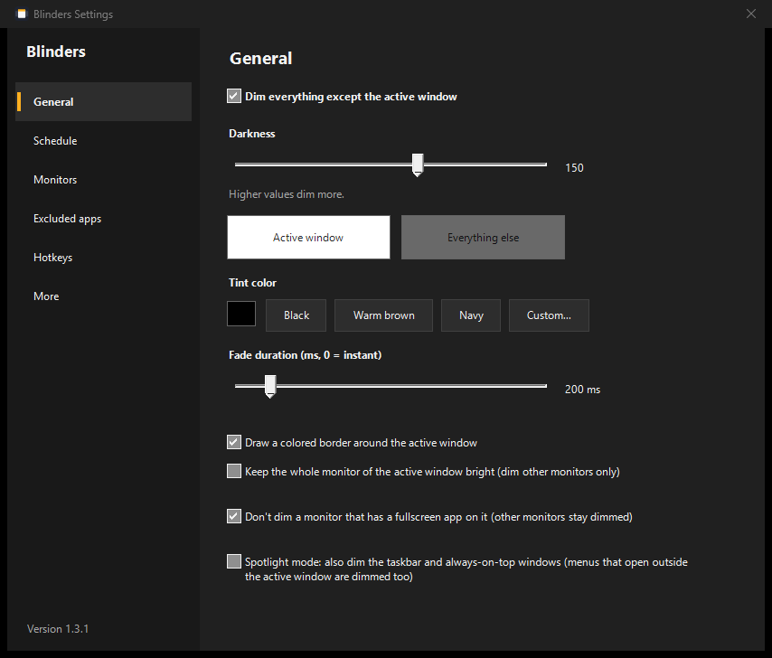
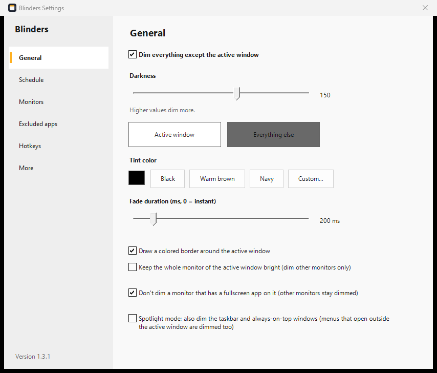

<p align="center">
  
</p>

<h1 align="center">Blinders</h1>

<p align="center">
  <b>Alles abdunkeln – außer dem Fenster, in dem du arbeitest.</b><br>
  Eine kleine Windows-Tray-App für Fokus – gemacht für schweifende Blicke, ADHS und volle Multi-Monitor-Schreibtische.
</p>

<p align="center">
  
  
  
  
  
</p>

<p align="center">
  <a href="README.md">English</a> ·
  <a href="README.ko.md">한국어</a> ·
  <a href="README.ja.md">日本語</a> ·
  <a href="README.zh-CN.md">简体中文</a> ·
  <a href="README.es.md">Español</a> ·
  <b>Deutsch</b> ·
  <a href="README.fr.md">Français</a>
</p>

<p align="center">
  
  
</p>

## Warum

Wie Scheuklappen beim Rennpferd: Das Fenster, das du gerade benutzt, bleibt hell, alles andere tritt in den Hintergrund. Andere Fenster, andere Monitore, der Chat, der ständig blinkt – alles noch da, nur leise. Eine einzige exe, kein Installer, kein Konto, keine Telemetrie.

## Funktionen

- **Fokus-Abdunkeln** – alles außer dem aktiven Fenster wird abgedunkelt, auf jedem Monitor, auch bei unterschiedlicher Skalierung
- **Spotlight-Modus** – dunkelt auch die Taskleiste und Fenster im Vordergrund ab
- **Aktiven Monitor hell lassen** – nur die anderen Monitore werden abgedunkelt
- **Vollbild-Erkennung** – ein Monitor mit Spiel oder Vollbild-Video bleibt unverändert, die anderen werden weiter abgedunkelt
- **Nachtzeitplan** – eine andere Dunkelheit zu den gewählten Uhrzeiten
- **Farbiger Rahmen** um das aktive Fenster (optional), **Farbtöne**, **Überblendungen**
- **Ausgenommene Apps** – kein Abdunkeln, solange sie aktiv sind; Auswahl aus laufenden Apps
- **Pause** für 10 Minuten oder 1 Stunde, **mit Windows starten**
- **Tastenkürzel** für alles, frei anpassbar
- **Helles / dunkles Einstellungsfenster**, das Windows folgt, mit anklickbarer Monitorübersicht
- **30 Sprachen**, Rechts-nach-links-Layout für Arabisch, Persisch und Hebräisch

## Download

1. `Blinders-x.y.z.zip` unter [Releases](../../releases) herunterladen.
2. An einen beliebigen Ort entpacken und `Blinders.exe` starten. Beim ersten Start öffnen sich die Einstellungen.
3. Windows 10/11 bringt alles Nötige schon mit (.NET Framework 4.8). Ein Download für 64- und 32-Bit-Windows, auch auf ARM64-PCs.

> Die exe ist noch nicht signiert, daher kann SmartScreen beim ersten Start warnen: **Weitere Informationen → Trotzdem ausführen** klicken.

## Bedienung

Blinders sitzt im Infobereich der Taskleiste (der `^`-Bereich neben der Uhr). **Linksklick** auf das Symbol öffnet die Einstellungen, **Rechtsklick** das Schnellmenü. Das Symbol zeigt den Zustand: an, aus oder pausiert.

| Tastenkürzel | Aktion |
|---|---|
| `Ctrl` + `Alt` + `Win` + `D` | Abdunkeln ein / aus |
| `Ctrl` + `Alt` + `Win` + `↑` / `↓` | Dunkler / heller |
| `Ctrl` + `Alt` + `Win` + `E` | Aktuelle App zu den Ausnahmen hinzufügen / entfernen |
| `Ctrl` + `Alt` + `Win` + `Q` | Beenden |

Tastenkürzel lassen sich unter **Einstellungen → Tastenkürzel** ändern. Die Standardwerte sind so gewählt, dass sie anderen Apps keine Tasten wegnehmen.

Wird `Blinders.exe` erneut gestartet, öffnen sich nur die Einstellungen. Eine neuere Version ersetzt die alte sauber.

**Einstellungen** liegen in `%APPDATA%\Blinders\Blinders.ini`. **Portabler Modus:** Liegt eine `Blinders.ini` (auch leer) neben der `Blinders.exe`, wird diese Datei verwendet.

## Sprachen

English · 简体中文 · 繁體中文 · हिन्दी · Español · Français · العربية · বাংলা · Português · Русский · 日本語 · Deutsch · 한국어 · Türkçe · Tiếng Việt · Italiano · ไทย · Bahasa Indonesia · Polski · Українська · Nederlands · فارسی · עברית · Svenska · Čeština · Română · Ελληνικά · Magyar · Dansk · Suomi

Die Systemsprache wird automatisch verwendet (ändern unter Einstellungen → Mehr → Sprache). Die meisten Übersetzungen sind Entwürfe – **Korrekturen sind sehr willkommen.**

**Sprache korrigieren oder hinzufügen, ohne zu kompilieren:** Einstellungen → Mehr → *Sprachvorlage exportieren*, `template.ini` übersetzen, als `lang\<Code>.ini` (z. B. `pt-BR.ini`) speichern und Blinders neu starten. Fehlende Zeilen erscheinen auf Englisch. Damit alle sie bekommen, einfach einen Pull Request mit der Datei in [`lang/`](lang) öffnen.

## Aus dem Quellcode bauen

Kein SDK nötig – Windows bringt den C#-Compiler mit.

```bat
build.bat      :: bin\Blinders.exe
release.bat    :: dist\Blinders-<Version>.zip
```

Beim Bauen werden alle `lang\*.ini` in die exe eingebettet.

## Lizenz

[MIT](LICENSE) © 2026 parkjs1362 · [Änderungsprotokoll](CHANGELOG.md)
